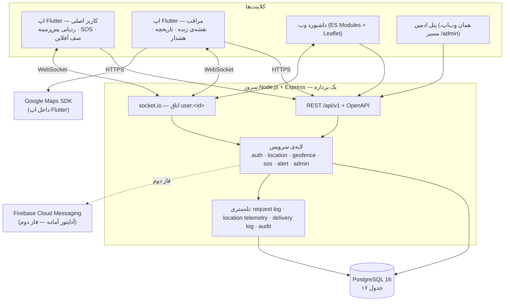

# گام ۱ — تحلیل دمو، معماری نهایی، ERD و تغییرات دیتابیس

سامانه‌ی «هم‌قدم / SafeStep» · فاز اول پروپوزال: توسعه‌ی معماری Client-Server و پیاده‌سازی رابط کاربری

---

## ۱. تحلیل وضعیت موجود (دمو)

### ۱.۱ آنچه سالم است و نگه داشته می‌شود

بک‌اند دمو ساختار لایه‌ایِ درستی دارد و بازنویسی نمی‌خواهد:

```
routes → controllers → services → repositories → db
```

نقاطی که به‌صراحت **حفظ** می‌شوند، چون فازهای دو و سه روی همین‌ها سوار می‌شوند:

| بخش | چرا نگه داشته می‌شود |
|---|---|
| جداییِ `services` از `repositories` | منطق دامنه از SQL جداست؛ افزودن PostGIS در آینده فقط repository را عوض می‌کند |
| `config/constants.js` به‌عنوان تنها منبع حقیقت | نام رویدادهای WebSocket و انواع هشدار بین بک‌اند، وب و اپ Flutter مشترک‌اند |
| `db/index.js` با دو درایور (pg / PGlite) | همان SQL روی هر دو مسیر؛ تحویل به کارفرما بدون وابستگی به Docker ممکن می‌ماند |
| مهاجرت‌های نسخه‌بندی‌شده و تراکنشی | تغییرات این فاز به‌صورت مهاجرت افزوده می‌شوند، نه ویرایش فایل ۰۰۱ |
| مدل اتاق `user:<id>` در socket.io | ارسال هدفمند؛ هیچ رویدادی به سوکتی که مخاطبش نیست نمی‌رسد |
| موتور Geofence با ماشین حالت در جدول `zone_states` | ارتقای فاز دوم روی همین ماشین حالت انجام می‌شود |
| `logger` با فهرست کلیدهای حساس | قاعده‌ی «مختصات هرگز خام لاگ نمی‌شود» در همین فاز به لاگ دیتابیسی هم تعمیم داده شد |

### ۱.۲ شکاف‌های واقعی که این فاز پر می‌کند

| # | شکاف | اثر بر پروپوزال |
|---|---|---|
| ۱ | **اپ Flutter وجود ندارد** | «توسعه‌ی اپلیکیشن تحت موبایل» عملاً انجام نشده است |
| ۲ | **مختصات شبیه‌سازی‌شده است** | متغیر ارزیابیِ «دقت موقعیت‌یابی» قابل اندازه‌گیری نیست |
| ۳ | **نقش ادمین وجود ندارد** | پروپوزال صریحاً سه نقش کاربری تعریف کرده است |
| ۴ | **لاگ سرور فقط روی stdout است** | «تأخیر سیستم» و «دقت موقعیت‌یابی» ابزار سنجش ندارند؛ لاگ کنسولی پس از ری‌استارت از بین می‌رود و قابل تحلیل آماری نیست |
| ۵ | **مستند API وجود ندارد** | سه کلاینت باید روی یک قرارداد کار کنند؛ بدون سند، قرارداد در کد پنهان می‌ماند |
| ۶ | **دسته‌ای/تکراری‌نشدنیِ پینگ پشتیبانی نمی‌شود** | صف آفلاین اپ بدون این دو، داده‌ی تکراری تولید می‌کند |

### ۱.۳ چیزهایی که عمداً تغییر **نمی‌کنند**

- شبیه‌ساز حذف نمی‌شود. با ورود موقعیت واقعی، شبیه‌ساز به ابزار دمو و تست تبدیل می‌شود و ستون `is_simulated` صداقتِ داده را حفظ می‌کند — این برای دفاع پایان‌نامه ارزش دارد، نه بدهی فنی.
- PGlite حذف نمی‌شود. مسیر رسمی استقرار `docker compose` با PostgreSQL واقعی است؛ PGlite فقط مسیر جایگزینِ اجرای بدون Docker می‌ماند.
- مدل «نقش واقعی از جدول `guardianships` می‌آید، نه از ستون `role`» حفظ می‌شود. ستون `role` فقط نقشِ پیش‌فرضِ حساب است.

---

## ۲. معماری نهایی

### ۲.۱ نمای کلان



### ۲.۲ تصمیم‌های معماری و دلیلشان

**الف) یک سرویس یکپارچه، نه میکروسرویس.**
مقیاس هدفِ این محصول (چند ده تا چند صد کاربر همزمان) با یک پردازه‌ی Node پوشش داده می‌شود. تقسیم زودهنگام، فقط پیچیدگیِ استقرار و تأخیر شبکه اضافه می‌کرد — و تأخیر، دقیقاً یکی از متغیرهای ارزیابی پایان‌نامه است.

**ب) WebSocket برای مسیر زنده، FCM برای وقتی اپ بسته است.**
این دو رقیب هم نیستند، مکمل‌اند. اپ باز = WebSocket (تأخیر زیر یک ثانیه). اپ بسته = FCM. آداپتور نوتیفیکیشن همین حالا هر دو را می‌شناسد و در نبود کلید FCM روی WebSocket می‌افتد؛ در فاز دوم فقط کلید اضافه می‌شود.

**ج) لاگ در دیتابیس، نه فقط در stdout.**
پروپوزال «لاگ‌های سرور» را ابزار سنجشِ دو متغیر اصلی تعریف کرده است. لاگ کنسولی نه پس از ری‌استارت می‌ماند و نه با SQL قابل تحلیل است. سه جدول جدا اضافه شد چون سه سؤال متفاوت می‌پرسند:
- `request_logs` → «سرور چقدر طول کشید؟»
- `location_telemetry` → «از گوشی تا سرور چقدر طول کشید و دقت مکان چقدر بود؟»
- `alert_deliveries` → «از تولید هشدار تا رسیدنش به مراقب چقدر طول کشید؟»

**د) نقش ادمین در همان جدول `users`، نه جدول جدا.**
یک ستون `role` با مقدار سوم، به‌علاوه‌ی میان‌افزار `requireRole('admin')`. جدول جدا یعنی دو مسیر احراز هویت و دو سطح باگ امنیتی. ادمین از مسیر ثبت‌نام ساخته نمی‌شود؛ فقط با اسکریپت `npm run create:admin` یا با ارتقای دستی توسط ادمین موجود.

**ه) پنل ادمین = همان وب‌اپ، نه پروژه‌ی سوم.**
مسیر `/admin` در همان داشبورد، پشت گاردِ نقش. سه کلاینت روی یک قرارداد API — همان خواسته‌ی «یکپارچه‌سازی» در صورت مسئله.

**و) بی‌اثرسازیِ تکرار (idempotency) در سطح دیتابیس.**
صف آفلاینِ اپ ممکن است یک دسته را دو بار بفرستد (قطع اتصال پس از دریافت سرور و پیش از رسیدن پاسخ). به‌جای اعتماد به منطق کلاینت، ستون `client_uuid` با ایندکس یکتا اضافه شد: تکرار در سطح دیتابیس غیرممکن می‌شود.

### ۲.۳ ساختار نهایی مخزن

```
safestep/
├── backend/                  Node.js + Express + PostgreSQL
│   ├── src/
│   │   ├── config/           env.js · constants.js
│   │   ├── controllers/      شامل adminController (گام ۲)
│   │   ├── services/         شامل telemetryService · adminService · auditService (گام ۲)
│   │   ├── repositories/     شامل logRepository · adminRepository (گام ۲)
│   │   ├── middleware/       auth · validate · rateLimit · error · requestLog (گام ۲)
│   │   ├── realtime/         socket.js · hub.js
│   │   ├── db/migrations/    001_init.sql · 002_phase1_admin_and_telemetry.sql
│   │   └── docs/             openapi.yaml (گام ۷)
│   └── tests/
├── web/                      داشبورد + پنل ادمین (بدون مرحله‌ی بیلد)
├── mobile/                   ← پروژه‌ی Flutter (گام‌های ۳ تا ۶)
│   └── lib/
│       ├── core/             theme · network · storage · error · accessibility
│       ├── features/         auth · pairing · tracking · sos · map · history · settings
│       └── shared/           ویجت‌های مشترک
├── docs/phase1/              مستندات این فاز
└── docker-compose.yml
```

---

## ۳. ERD نهایی

جدول‌های مهاجرت ۰۰۱ با خط عادی و جدول‌های افزوده‌ی این فاز با برچسب «جدید» مشخص شده‌اند.

```mermaid
erDiagram
    users ||--o| user_settings : "تنظیمات"
    users ||--o{ devices : "دستگاه‌ها"
    users ||--o{ refresh_tokens : "نشست‌ها"
    users ||--o{ safe_zones : "محدوده‌های امن"
    users ||--o{ location_pings : "پینگ موقعیت"
    users ||--o{ alerts : "هشدارها"
    users ||--o{ guardianships : "کاربر اصلی"
    users ||--o{ invite_codes : "کد دعوت"
    users ||--o{ zone_states : "وضعیت محدوده"
    users ||--o{ alert_reads : "خوانده‌شده‌ها"
    users ||--o{ request_logs : "لاگ درخواست (جدید)"
    users ||--o{ location_telemetry : "تله‌متری (جدید)"
    users ||--o{ alert_deliveries : "تحویل هشدار (جدید)"
    users ||--o{ audit_logs : "حسابرسی (جدید)"
    users ||--o{ notification_outbox : "صف نوتیفیکیشن (جدید)"
    users ||--o{ fall_events : "رویداد سقوط (جدید)"

    safe_zones ||--o{ zone_states : "ماشین حالت"
    safe_zones ||--o{ alerts : "منشأ هشدار"
    alerts ||--o{ alert_reads : "وضعیت خواندن"
    alerts ||--o{ alert_deliveries : "تحویل"
    alerts ||--o| fall_events : "هشدار سقوط"
    location_pings ||--o| location_telemetry : "سنجه"

    users {
        uuid id PK
        varchar phone UK
        text password_hash
        text full_name
        varchar role "primary|guardian|admin ← گسترش‌یافته"
        varchar status "active|suspended|deleted ← جدید"
        text suspended_reason "جدید"
        timestamptz last_login_at "جدید"
        timestamptz phone_verified_at "جدید"
        timestamptz deleted_at "جدید"
    }

    user_settings {
        uuid user_id PK
        boolean location_sharing_enabled
        integer long_stop_minutes
        integer long_stop_radius_m
        text_array alert_types
        integer ping_interval_sec "جدید"
        boolean background_tracking_enabled "جدید"
        real text_scale "جدید — دسترس‌پذیری"
        boolean high_contrast_enabled "جدید"
        boolean haptic_feedback_enabled "جدید"
        integer location_retention_days "جدید"
    }

    devices {
        uuid id PK
        uuid user_id FK
        varchar platform "android|ios|web"
        text push_token
        integer battery_level
        uuid install_id "جدید — شناسه‌ی پایدار نصب"
        varchar app_version "جدید"
        varchar os_version "جدید"
        varchar model "جدید"
        timestamptz last_ping_at "جدید"
        timestamptz revoked_at "جدید"
    }

    location_pings {
        bigserial id PK
        uuid user_id FK
        float8 lat
        float8 lng
        real accuracy_m
        integer battery_level
        boolean is_simulated
        varchar source "جدید — device|simulator|import"
        varchar provider "جدید — gps|fused|network"
        boolean is_queued_replay "جدید"
        uuid client_uuid "جدید — کلید بی‌اثرسازی تکرار"
        timestamptz recorded_at
        timestamptz received_at "جدید"
    }

    request_logs {
        bigserial id PK
        uuid request_id
        uuid user_id FK
        varchar method
        text route "الگوی مسیر، نه مسیر واقعی"
        integer status_code
        integer latency_ms
        varchar error_code
        varchar ip_hash "HMAC — نه IP خام"
    }

    location_telemetry {
        bigserial id PK
        uuid user_id FK
        bigint ping_id FK
        integer e2e_latency_ms "گوشی تا سرور"
        integer process_ms "پردازش سرور"
        real accuracy_m
        integer batch_size
        boolean is_queued_replay
        integer gap_sec
    }

    alert_deliveries {
        bigserial id PK
        uuid alert_id FK
        uuid recipient_user_id FK
        varchar channel "websocket|fcm|log|sms"
        varchar status
        integer latency_ms
        timestamptz acknowledged_at
    }

    audit_logs {
        bigserial id PK
        uuid actor_user_id FK
        varchar action
        varchar entity_type
        text entity_id
        jsonb metadata
        varchar ip_hash
    }

    notification_outbox {
        bigserial id PK
        uuid user_id FK
        uuid alert_id FK
        jsonb payload
        varchar status
        integer attempts
        timestamptz next_attempt_at
    }

    fall_events {
        uuid id PK
        uuid user_id FK
        uuid alert_id FK
        varchar model_name "SVM|KNN — فاز سوم"
        real confidence
        jsonb features
        varchar user_feedback "ورودی ماتریس درهم‌ریختگی"
    }
```



---

## ۴. تغییرات دیتابیس — مهاجرت ۰۰۲

فایل: `backend/src/db/migrations/002_phase1_admin_and_telemetry.sql`

فایل ۰۰۱ **دست نخورده** است. کل تغییرات به‌صورت یک مهاجرت افزوده اعمال می‌شود تا هر نصب موجود (از جمله دموی فعلی کارفرما) بدون از دست دادن داده به‌روز شود.

| گروه | تغییر | چرا |
|---|---|---|
| نقش و حساب | `users.role` → افزودن `admin` | نقش سوم پروپوزال |
| | `status`, `suspended_reason`, `deleted_at` | تعلیق و حذف نرم توسط ادمین؛ حذف سخت ممکن نیست چون لاگ‌های سنجش به کاربر ارجاع دارند |
| | `last_login_at`, `phone_verified_at` | پنل ادمین و آمادگی تأیید پیامکی |
| دستگاه | `install_id` + ایندکس یکتا | ثبت مجدد پس از تعویض توکن FCM، ردیف تکراری نسازد |
| | `app_version`, `os_version`, `model`, `last_ping_at`, `revoked_at` | مدیریت دستگاه در پنل ادمین |
| پینگ | `source`, `provider` | تفکیک دستگاه واقعی از شبیه‌ساز؛ تفکیک GPS خالص از موقعیت ترکیبی |
| | `client_uuid` + ایندکس یکتای جزئی | بی‌اثرسازی تکرارِ صف آفلاین در سطح دیتابیس |
| | `is_queued_replay`, `received_at` | پینگ‌های تأخیری در میانگین «تأخیر سیستم» وارد نشوند |
| لاگ | `request_logs` | سنجش تأخیر سرور |
| | `location_telemetry` | سنجش تأخیر سرتاسری و دقت موقعیت‌یابی |
| | `alert_deliveries` | سنجش تأخیر رسیدن هشدار به مراقب |
| | `audit_logs` | پاسخ‌گویی کنش‌های ادمین و کنش‌های حساس کاربر |
| فاز دوم | `notification_outbox` | ارسال FCM قابل بازتلاش، بدون تغییر شما در آینده |
| فاز سوم | `fall_events` + نوع هشدار `fall_detected` | جای نشستن خروجی SVM/KNN؛ رابط کاربری همین فاز پذیرایش است |
| تنظیمات | `ping_interval_sec`, `background_tracking_enabled` | کنترل موازنه‌ی دقت و باتری از سمت سرور |
| | `text_scale`, `high_contrast_enabled`, `haptic_feedback_enabled` | دسترس‌پذیری؛ با تعویض گوشی از دست نرود |
| | `location_retention_days` | کمینه‌سازی داده، پیش‌فرض ۹۰ روز |

**وضعیت اجرا:** مهاجرت روی دیتابیس تازه اجرا شد و هر ۸۳ تست موجود پس از آن سبز ماند.

### حریم خصوصی در جدول‌های لاگ — قاعده‌ی الزام‌آور

سه قاعده که در گام ۲ در کد اعمال می‌شود و در بازبینی کد شرط پذیرش است:

1. **هیچ مختصاتی** در `request_logs`، `audit_logs` یا `metadata` نوشته نمی‌شود. `location_telemetry` فقط `accuracy_m` را نگه می‌دارد، نه `lat/lng` — دقت، سنجه است؛ مختصات، داده‌ی شخصی.
2. **IP خام ذخیره نمی‌شود.** فقط `HMAC-SHA256(ip, server_key)` در ستون `ip_hash` — شمارشِ «چند درخواست از یک مبدأ» ممکن می‌ماند، بازیابی خودِ IP نه.
3. **مسیر، الگوی مسیر است نه مسیر واقعی**: `/api/v1/alerts/:id` ذخیره می‌شود، نه `/api/v1/alerts/9f3c…` — تا شناسه‌ها در لاگ ننشینند.

---

## ۵. قرارداد API — تغییرات این فاز

قرارداد موجود **شکسته نمی‌شود**؛ فقط افزوده می‌شود. سه کلاینت روی همین قرارداد کار می‌کنند.

| مسیر | تغییر | گام |
|---|---|---|
| `POST /api/v1/locations/ping` | افزودن فیلدهای اختیاری `clientUuid`، `provider`، `isQueuedReplay` — بدون آن‌ها دقیقاً مثل قبل کار می‌کند | ۲ |
| `POST /api/v1/locations/batch` | **جدید** — ارسال دسته‌ای تا ۲۰۰ پینگ برای تخلیه‌ی صف آفلاین | ۲ |
| `POST /api/v1/devices` | افزودن `installId`، `appVersion`، `osVersion`، `model` | ۲ |
| `GET /api/v1/admin/users` و افزوده‌های آن | **جدید** — فهرست، جست‌وجو، تعلیق، فعال‌سازی، تغییر نقش | ۲ |
| `GET /api/v1/admin/devices` | **جدید** — فهرست و ابطال دستگاه | ۲ |
| `GET /api/v1/admin/logs/requests` · `/logs/audit` | **جدید** — مشاهده‌ی لاگ با فیلتر | ۲ |
| `GET /api/v1/admin/metrics` | **جدید** — میانگین و صدک‌های تأخیر و دقت؛ همان اعداد جدول ارزیابی پایان‌نامه | ۲ |
| `PATCH /api/v1/settings` | افزودن کلیدهای بازه‌ی پینگ و دسترس‌پذیری | ۲ |
| `GET /api/v1/config/client` | **جدید** — پیکربندی اپ (بازه‌ی پینگ، آستانه‌ها) بدون نیاز به انتشار نسخه‌ی جدید | ۲ |

---

## ۶. آنچه در گام‌های بعد ساخته می‌شود

| گام | خروجی |
|---|---|
| ۲ | میان‌افزار لاگ درخواست، سرویس تله‌متری و حسابرسی، نقش و پنل ادمین، ارسال دسته‌ای پینگ، اسکریپت ساخت ادمین، تست‌های جدید |
| ۳ | اسکلت پروژه‌ی Flutter، دیزاین‌سیستم، RTL و Vazirmatn، ناوبری، لایه‌ی دسترس‌پذیری |
| ۴ | ثبت‌نام، ورود، مدیریت توکن، اتصال با کد دعوت و QR |
| ۵ | موقعیت‌یابی واقعی، سرویس Foreground، صف آفلاین، WebSocket، SOS |
| ۶ | نقشه‌ی Google Maps سمت مراقب، تاریخچه‌ی مسیر، تنظیمات |
| ۷ | OpenAPI، docker-compose نهایی، گزارش فارسی فاز اول |
