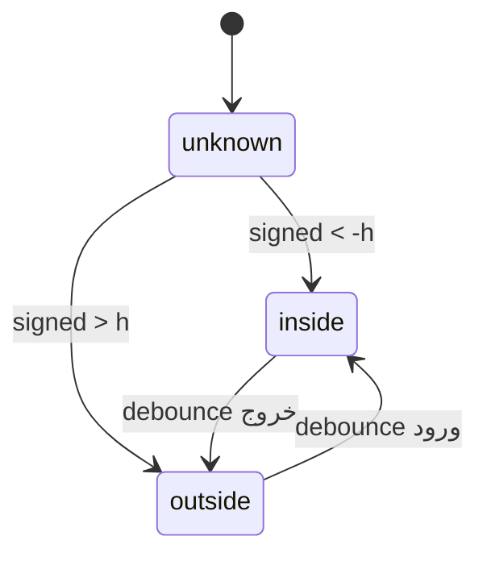

# Geofence فاز دوم

موتور قبلی فقط دایره داشت. حالا هر محدوده یک **فاصلهٔ علامت‌دار تا مرز** دارد: منفی یعنی داخل، مثبت یعنی بیرون. هیسترزیس همان باند مرده است (±h). برای چندضلعی، h حداکثر ۴۰٪ شعاع محاط تقریبی (کمینه فاصلهٔ مرکز ثقل تا یال) است.

زمان‌بندی با `Intl` و منطقهٔ `Asia/Tehran` است. پنجره‌ای که `from > to` دارد از نیمه‌شب عبور می‌کند. وقتی پنجره خاموش است وضعیت به‌روز می‌شود ولی هشدار صادر نمی‌شود.

هشدار ماندگاری: اگر کاربر بیرون بماند و `dwell_alert_minutes` گذشته باشد، دوباره `zone_exit` با متن ماندگاری می‌آید.

پینگ تطبیقی روی گوشی: سرعت کمتر از ۰٫۵ متر بر ثانیه برای ۵ دقیقه → بازهٔ ایستا و دقت medium.

آزمایش لرزش روی مرز چندضلعی تهران در تست واحد: ۲۰ نقطهٔ جیتِر، صفر هشدار خروج.
