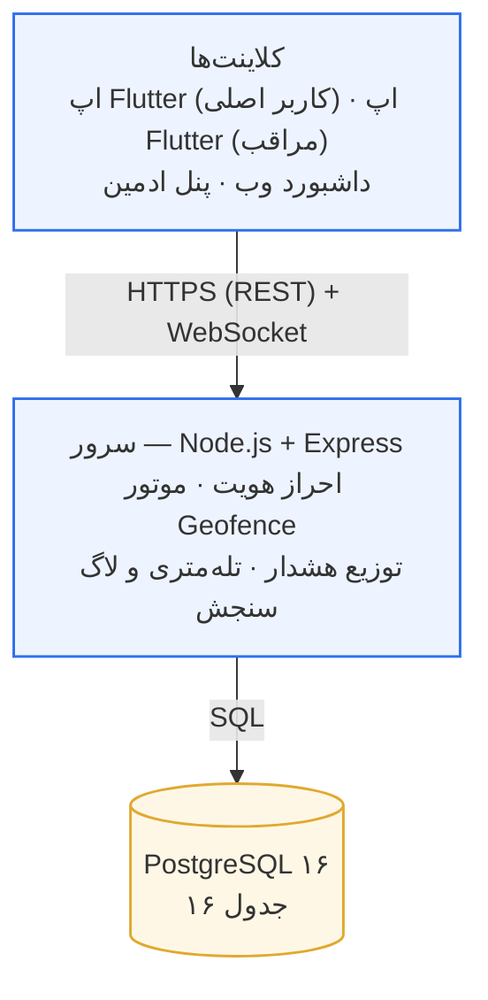
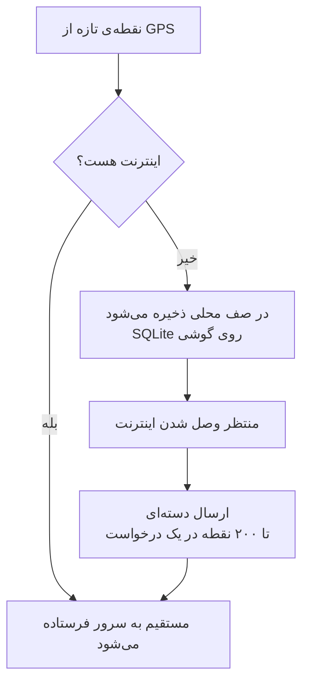

<div dir="rtl" align="right">

# راهنمای فهم، ارائه و دفاع

**سامانه‌ی هم‌قدم (SafeStep)**

> این سند با بقیه‌ی مستندات پروژه فرق دارد. آن‌ها گزارش کارند؛ این یکی **آموزش** است.
> فرض این سند این است که شما می‌خواهید این سیستم را بفهمید، در جلسه ارائه کنید، و به
> سؤال داور جواب بدهید — نه اینکه کدش را بنویسید.
>
> برای خواندنش نیازی به دانستن Node.js یا Flutter نیست.

</div>

---

<div dir="rtl" align="right">

## فهرست

| بخش | عنوان | برای چه وقتی |
|:--|:--|:--|
| ۱ | [این سیستم چه مسئله‌ای را حل می‌کند](#۱-این-سیستم-چه-مسئلهای-را-حل-میکند) | شروع ارائه |
| ۲ | [معماری در یک نگاه](#۲-معماری-در-یک-نگاه) | سؤال «ساختارش چیست؟» |
| ۳ | [سفر یک نقطه: از GPS تا نقشه‌ی مراقب](#۳-سفر-یک-نقطه-از-gps-گوشی-تا-نقشهی-مراقب) | سؤال «چطور کار می‌کند؟» |
| ۴ | [هفت تصمیم فنی و دلیلشان](#۴-هفت-تصمیم-فنی-و-دلیلشان) | سؤال «چرا این‌طوری؟» |
| ۵ | [متغیرهای ارزیابی: چطور عدد در بیاورید](#۵-متغیرهای-ارزیابی-چطور-عدد-در-بیاورید) | نوشتن فصل نتایج |
| ۶ | [سناریوی نمایش زنده در جلسه](#۶-سناریوی-نمایش-زنده-در-جلسهی-دفاع) | خودِ جلسه |
| ۷ | [بیست سؤال محتمل داور و جوابشان](#۷-بیست-سؤال-محتمل-داور-و-جوابشان) | شب قبل از دفاع |
| ۸ | [نقشه‌ی کد: کجا دنبال چه بگردید](#۸-نقشهی-کد-کجا-دنبال-چه-بگردید) | اگر داور کد خواست |
| ۹ | [واژه‌نامه](#۹-واژهنامه) | هر وقت اصطلاحی لازم شد |

</div>

---

<div dir="rtl" align="right">

## ۱. این سیستم چه مسئله‌ای را حل می‌کند

### صورت مسئله در یک جمله

فرد نابینا، سالمند یا دارای محدودیت حرکتی می‌خواهد **مستقل** بیرون برود. خانواده‌اش
می‌خواهند **نگران نباشند**. این دو خواسته با هم در تنش‌اند.

### چرا این تنش مهم است

راه‌حل ساده‌انگارانه این است که خانواده همیشه موقعیت فرد را ببیند. اما پژوهش‌های
حوزه‌ی سالمندی نشان می‌دهد نظارت دائمی، حس استقلال را از بین می‌برد و کاربر یا اپ
را حذف می‌کند یا گوشی را جا می‌گذارد — یعنی دقیقاً همان چیزی که قرار بود امنیت
بیاورد، امنیت را از بین می‌برد.

> **پس مسئله‌ی واقعی این نیست که «چطور فرد را ردیابی کنیم»، بلکه این است که «چطور
> امنیت بدهیم بدون آنکه استقلال را بگیریم».**

### پاسخ این سیستم

| اصل | چطور در سیستم پیاده شده |
|:--|:--|
| کاربر همیشه می‌داند چه کسی او را می‌بیند | فهرست مراقبان روی صفحه‌ی اول، نه پشت منو |
| کاربر هر لحظه می‌تواند قطع کند | کلید اشتراک‌گذاری، با اثر فوری |
| قطع کردن، امنیت را از بین نمی‌برد | دکمه‌ی SOS حتی در حالت قطع هم کار می‌کند |
| مراقب فقط چیزی را می‌بیند که کاربر داده | سه سطح دسترسی مجزا، انتخاب‌شده توسط خودِ کاربر |
| تاریخچه‌ی کاربر مال خودش است | با قطع اشتراک، ثبت ادامه دارد ولی پخش متوقف می‌شود |

**این نکته را در دفاع برجسته کنید.** بیشتر پروژه‌های مشابه فقط ردیابی می‌کنند.
تمایز این کار، همین موازنه است.

### سه گروه هدف و تفاوتشان

| گروه | نیاز خاص | پاسخ در سیستم |
|:--|:--|:--|
| نابینایان | نمی‌بینند | پشتیبانی کامل صفحه‌خوان، هر رویداد اعلام صوتی می‌شود |
| محدودیت حرکتی | لمس دقیق سخت است | هدف لمسی ۵۶ نقطه (استاندارد ۴۸ است) |
| سالمندان | متن ریز خوانده نمی‌شود | بزرگ‌نمایی تا ۲ برابر، کنتراست بالا |

</div>

---

<div dir="rtl" align="right">

## ۲. معماری در یک نگاه

### سه لایه

</div>



<div dir="rtl" align="right">

### چرا این معماری

**چرا Client-Server و نه همتا‌به‌همتا (P2P)؟**
موقعیت باید حتی وقتی گوشی مراقب خاموش است ثبت شود. با P2P، اگر دو طرف هم‌زمان
آنلاین نباشند، داده‌ای منتقل نمی‌شود.

**چرا یک سرویس یکپارچه و نه میکروسرویس؟**
مقیاس هدف این محصول چند ده تا چند صد کاربر همزمان است. تقسیم زودهنگام فقط پیچیدگی
استقرار و **تأخیر شبکه** اضافه می‌کرد — و تأخیر، خودش یکی از متغیرهای ارزیابی
پایان‌نامه است.

**چرا هم REST و هم WebSocket؟**
این دو رقیب نیستند، مکمل‌اند:

- **REST** یک «عکس لحظه‌ای» می‌دهد ← برای باز کردن صفحه
- **WebSocket** یک «جریان تغییرات» می‌دهد ← برای حرکت زنده‌ی نشانگر

اگر فقط REST بود، نقشه تا رفرش بعدی ثابت می‌ماند. اگر فقط WebSocket بود، تا رسیدن
اولین رویداد (تا ۳۰ ثانیه) صفحه خالی بود.

### سه نقش کاربری

| نقش | چه می‌بیند | چه نمی‌بیند |
|:--|:--|:--|
| **کاربر اصلی** | وضعیت خودش، مراقبانش، تاریخچه‌ی خودش | — |
| **مراقب** | فقط آنچه کاربر اصلی اجازه داده | داده‌ی کاربرانی که به او دسترسی نداده‌اند |
| **مدیر سامانه** | حساب‌ها، دستگاه‌ها، لاگ‌ها، سنجه‌ها | **موقعیت هیچ‌کس** |

> **نکته‌ی مهم برای دفاع:** اینکه ادمین به موقعیت دسترسی ندارد یک فراموشی نیست،
> تصمیم است. اگر یک نقش سرتاسری بتواند موقعیت همه را ببیند، همان چیزی را نقض
> کرده‌ایم که ادعای محافظت از آن را داریم. یک تست خودکار این را قفل کرده است.

</div>

---

<div dir="rtl" align="right">

## ۳. سفر یک نقطه: از GPS گوشی تا نقشه‌ی مراقب

> این بخش را خوب یاد بگیرید. اگر داور بپرسد «سیستم چطور کار می‌کند؟»، جواب همین است.

### گام ۱ — خواندن از حسگر (روی گوشی کاربر)

اپ هر ۳۰ ثانیه از GPS گوشی موقعیت می‌خواند. این بازه از **سرور** می‌آید نه از داخل
اپ، تا بشود بدون انتشار نسخه‌ی جدید تغییرش داد.

همان لحظه، اپ برای این نقطه یک **شناسه‌ی یکتا** می‌سازد. چرا مهم است؟ در گام ۴
می‌بینید.

### گام ۲ — تصمیم: بفرست یا در صف بگذار

</div>



<div dir="rtl" align="right">

صف سقف دارد. وقتی پر شد، **قدیمی‌ترین‌ها** حذف می‌شوند نه جدیدترین‌ها — چون در یک
سامانه‌ی ایمنی، موقعیت نیم‌ساعت پیش از موقعیت دیروز مهم‌تر است.

### گام ۳ — سرویس Foreground: چرا اپ بسته هم کار می‌کند

اندروید اپ‌هایی که در پس‌زمینه‌اند را ظرف چند دقیقه می‌کشد تا باتری صرفه‌جویی شود.
تنها راه قانونیِ ادامه‌ی کار، **سرویس Foreground** است: یک اعلان دائمی در نوار بالای
گوشی که به کاربر می‌گوید «این اپ در حال کار است».

این اعلان قابل حذف نیست و این هم عمدی است: کاربر باید همیشه بداند که ردیابی روشن
است.

### گام ۴ — رسیدن به سرور و مسئله‌ی تکرار

**سناریویی که واقعاً اتفاق می‌افتد:** اپ نقطه را می‌فرستد، سرور ذخیره می‌کند، و درست
پیش از رسیدن پاسخ، اینترنت قطع می‌شود. اپ فکر می‌کند ارسال شکست خورده و دوباره
می‌فرستد. نتیجه: یک نقطه، دو بار در دیتابیس.

**راه‌حل:** همان شناسه‌ای که در گام ۱ ساخته شد. دیتابیس یک قید یکتایی روی آن دارد،
پس درج دوم بی‌صدا نادیده گرفته می‌شود و سرور پاسخ موفق می‌دهد تا اپ صفش را خالی کند.

> **چرا شناسه در لحظه‌ی ثبت ساخته می‌شود نه هنگام ارسال؟**
> اگر هنگام ارسال ساخته می‌شد، دو نسخه‌ی همان نقطه دو شناسه‌ی متفاوت می‌گرفتند و قید
> یکتایی هیچ کاری نمی‌توانست بکند.

### گام ۵ — خط لوله‌ی پردازش در سرور

هر نقطه به‌ترتیب از این هفت مرحله عبور می‌کند:

۱. ذخیره در جدول `location_pings`
۲. به‌روزرسانی سطح باتری دستگاه
۳. پخش زنده به مراقبانِ مجاز (WebSocket)
۴. موتور Geofence ← هشدار خروج یا بازگشت
۵. تشخیص توقف طولانی ← هشدار توقف
۶. بررسی باتری کم ← هشدار باتری
۷. ثبت سنجه‌ها در جدول تله‌متری

> **نکته‌ی حریم خصوصی:** اگر کاربر اشتراک‌گذاری را خاموش کرده باشد، مرحله‌ی ۱ انجام
> می‌شود ولی مرحله‌های ۳ تا ۶ **متوقف** می‌شوند. حتی هشدار «از خانه خارج شد» هم
> ارسال نمی‌شود — چون خودِ آن هشدار هم یک نشت موقعیت است، حتی اگر مختصات را نفرستد.

### گام ۶ — رسیدن به مراقب

مراقب نقطه را از دو راه می‌گیرد: WebSocket (اگر اپ باز است) یا REST (وقتی صفحه را
باز می‌کند). اپ این دو را ادغام می‌کند.

**یک محافظ ظریف:** رویدادی که زمانش از آنچه داریم قدیمی‌تر باشد نادیده گرفته
می‌شود. ترتیب رسیدن بسته‌های شبکه تضمین‌شده نیست و یک بسته‌ی دیررسیده نباید نشانگر
را روی نقشه به عقب برگرداند.

</div>

---

<div dir="rtl" align="right">

## ۴. هفت تصمیم فنی و دلیلشان

> اینها را حفظ کنید. هر کدام احتمالاً یک سؤال داور است.

### ۴.۱ هیسترزیس در موتور Geofence

**مسئله:** GPS در محیط شهری ۱۰ تا ۳۰ متر خطا دارد. کاربری که روی مرز محدوده
ایستاده، با هر نوسان یک بار «خارج» و یک بار «داخل» تشخیص داده می‌شود. نتیجه: ده‌ها
هشدار کاذب در چند دقیقه.

**راه‌حل — سه لایه‌ی دفاعی:**

| لایه | چه می‌کند |
|:--|:--|
| **باند مرده** | آستانه‌ی خروج «شعاع + ۲۵ متر»، آستانه‌ی بازگشت «شعاع − ۲۵ متر». بین این دو، هیچ تصمیمی گرفته نمی‌شود |
| **debounce** | تغییر وضعیت باید در ۲ پینگ متوالی تأیید شود |
| **دوره‌ی خاموشی** | حداقل ۶۰ ثانیه بین دو هشدار هم‌نوع |

**عدد قابل ارائه** — روی ۲۰ پینگ نوسانی روی مرز:

| روش | تعداد هشدار کاذب |
|:--|:--|
| مقایسه‌ی ساده‌ی «فاصله > شعاع» | ۱۹ |
| موتور این پروژه | **۰** |

و یک خروج واقعی همچنان **دقیقاً یک** هشدار تولید می‌کند. این عدد ادعا نیست — یک
تست خودکار است که با `npm test` اجرا می‌شود.

### ۴.۲ چرا Flutter

پروپوزال Cross-Platform خواسته بود. Flutter یک کد برای اندروید و iOS می‌دهد، و
مهم‌تر برای این پروژه: کنترل کامل روی رندر متن، که برای فارسیِ راست‌به‌چپ با
پشتیبانی صفحه‌خوان حیاتی است.

### ۴.۳ چرا Riverpod برای مدیریت حالت

نکته‌ی تعیین‌کننده: سرویس ردیابی وقتی اپ بسته است باید به توکن و صف آفلاین دسترسی
داشته باشد — بدون هیچ صفحه‌ای، بدون `BuildContext`. با Riverpod این یک شیء مستقل از
رابط کاربری است. با Bloc باید یک لایه‌ی جداگانه کنارش ساخته می‌شد، یعنی عملاً دو
سیستم مدیریت حالت.

### ۴.۴ چرا توکن دو‌لایه (access + refresh)

توکن دسترسی ۱۵ دقیقه اعتبار دارد و توکن تازه‌سازی ۳۰ روز. اگر توکن کوتاه دزدیده
شود، ۱۵ دقیقه بیشتر به کار نمی‌آید.

توکن بلند هم **می‌چرخد**: با هر استفاده، نسخه‌ی قبلی باطل می‌شود. یعنی اگر دزدیده
شود، اولین استفاده‌ی هر یک از دو طرف دیگری را از کار می‌اندازد و سرقت حداکثر یک
چرخه دوام می‌آورد.

### ۴.۵ چرا کد دعوت با HMAC هش می‌شود نه bcrypt

فضای کد شش‌رقمی فقط یک میلیون حالت دارد. bcrypt جلوی حمله‌ی آنلاین را نمی‌گیرد — آن
کار را محدودیت نرخ و انقضای ۱۵ دقیقه‌ای می‌کند. ضمناً با bcrypt نمی‌شود مستقیم کوئری
زد و باید کل جدول پیمایش شود.

HMAC با کلیدی که **در دیتابیس نیست**، هم جست‌وجوی مستقیم می‌دهد و هم اگر دیتابیس نشت
کند، اجازه‌ی حمله‌ی آفلاین نمی‌دهد.

### ۴.۶ چرا تعلیق حساب از دیتابیس خوانده می‌شود نه از توکن

اگر نقش و وضعیت داخل توکن باشد، حسابی که مدیر همین حالا معلق کرده تا ۱۵ دقیقه به
کار خود ادامه می‌دهد. برای «تعلیق» این پذیرفتنی نیست.

راه‌حل: خواندن از دیتابیس با حافظه‌ی نهانِ ۱۵ ثانیه‌ای که با هر تغییر پاک می‌شود.
حداکثر تأخیر اثرگذاری: **۱۵ ثانیه، نه ۱۵ دقیقه**.

### ۴.۷ چرا لاگ در دیتابیس و نه در فایل

پروپوزال لاگ سرور را ابزار سنجش دو متغیر اصلی تعریف کرده بود. لاگ کنسولی نه پس از
ری‌استارت می‌ماند و نه با SQL قابل تحلیل است. بخش بعد را ببینید.

</div>

---

<div dir="rtl" align="right">

## ۵. متغیرهای ارزیابی: چطور عدد در بیاورید

> این بخش برای **فصل نتایج** پایان‌نامه است.

### چه چیزی اندازه‌گیری می‌شود

| متغیر | جدول دیتابیس | معنا |
|:--|:--|:--|
| دقت موقعیت‌یابی | `location_telemetry` | شعاع خطای گزارش‌شده توسط GPS، بر حسب متر |
| تأخیر سیستم | `request_logs` | زمان پردازش سرور، بر حسب میلی‌ثانیه |
| تأخیر سرتاسری | `location_telemetry` | از ثبت روی گوشی تا رسیدن به سرور |
| تأخیر رسیدن هشدار | `alert_deliveries` | از تولید هشدار تا باز کردنش توسط مراقب |

### چطور عدد بگیرید

۱. سرور را بالا بیاورید
۲. سناریوی بخش ۶ را با گوشی واقعی اجرا کنید (حداقل ۲۰ دقیقه راه رفتن)
۳. با حساب مدیر وارد شوید و این آدرس را باز کنید:

</div>

```
GET /api/v1/admin/metrics
```

<div dir="rtl" align="right">

پاسخ، جدول آماده‌ی فصل نتایج است.

گزارش تست بار (`npm run loadtest`) در `docs/evaluation/load-test-2026-09-06.md` درصدک‌های ناظر خارجی را کنار `request_logs` می‌گذارد.

### سه نکته که در فصل نتایج باید بنویسید

**۱. صدک گزارش کنید، نه فقط میانگین.**
میانگین وضعیت بدترین کاربران را پنهان می‌کند. صدک ۹۵ یعنی «۹۵ درصد درخواست‌ها بهتر
از این عدد بوده‌اند» — که برای یک سامانه‌ی ایمنی سؤال درست‌تری است. سیستم هر دو را
می‌دهد.

**۲. پینگ‌های تأخیری را کنار بگذارید و بگویید که کنار گذاشته‌اید.**
نقطه‌ای که دو ساعت در صف آفلاین مانده، تأخیرش اندازه‌ی قطعیِ اینترنت است نه کندی
سیستم. سیستم این‌ها را از میانگین حذف می‌کند **اما تعدادشان را جداگانه گزارش
می‌دهد** — این شفافیت، خودش یک امتیاز روش‌شناختی است.

**۳. تفکیک کنید که داده از کجا آمده.**
هر نقطه در دیتابیس مشخص می‌کند از دستگاه واقعی آمده یا از شبیه‌ساز. در فصل نتایج
فقط داده‌ی واقعی را گزارش کنید و این تفکیک را ذکر کنید.

### شکل پیشنهادی جدول در فصل نتایج

| سنجه | میانگین | صدک ۵۰ | صدک ۹۵ | تعداد نمونه |
|:--|:--|:--|:--|:--|
| دقت موقعیت‌یابی (متر) | | | | |
| تأخیر پردازش سرور (میلی‌ثانیه) | | | | |
| تأخیر گوشی تا سرور (میلی‌ثانیه) | | | | |
| تأخیر رسیدن هشدار (میلی‌ثانیه) | | | | |

</div>

---

<div dir="rtl" align="right">

## ۶. سناریوی نمایش زنده در جلسه‌ی دفاع

**زمان لازم: ۶ تا ۸ دقیقه.** با دو دستگاه (یا یک گوشی و یک شبیه‌ساز).

### آماده‌سازی پیش از جلسه

- [ ] سرور بالا و در دسترس (`docker compose up`)
- [ ] هر دو دستگاه به یک شبکه وصل
- [ ] حساب‌ها از قبل ساخته و متصل شده باشند (اتصال را در جلسه نشان دهید، ولی یک نسخه‌ی آماده هم داشته باشید)
- [ ] یک محدوده‌ی امن حول محل جلسه تعریف شده باشد
- [ ] **نقشه‌ی جایگزین:** اگر اینترنت قطع شد، شبیه‌ساز موقعیت را روشن کنید

### اجرا

| دقیقه | کار | چه بگویید |
|:--|:--|:--|
| ۰:۰۰ | صفحه‌ی کاربر اصلی | «کاربر می‌بیند چه کسی موقعیتش را می‌بیند — این روی صفحه‌ی اول است، نه پشت منو» |
| ۰:۳۰ | ساخت کد دعوت | «کاربر **پیش از** ساختن کد انتخاب می‌کند چه چیزی به اشتراک بگذارد» |
| ۱:۰۰ | اسکن QR با دستگاه دوم | «اتصال برقرار شد» |
| ۱:۳۰ | روشن کردن ارسال موقعیت | اعلان سرویس Foreground را نشان دهید: «کاربر همیشه می‌داند ردیابی روشن است» |
| ۲:۰۰ | نقشه روی دستگاه دوم | دایره‌ی دقت را نشان دهید: «نقطه‌ی تنها این توهم را می‌سازد که موقعیت دقیقاً همان‌جاست» |
| ۲:۳۰ | **چند قدم راه بروید** | نشانگر ظرف چند ثانیه حرکت می‌کند، بدون رفرش |
| ۳:۳۰ | خارج شدن از محدوده | هشدار خودکار روی دستگاه دوم |
| ۴:۰۰ | فشردن دکمه‌ی SOS | لرزش و پیام بحرانی روی دستگاه دوم |
| ۴:۳۰ | **قطع اینترنت و راه رفتن** | «در صف: ۵ نقطه» |
| ۵:۰۰ | وصل کردن اینترنت | صف تخلیه می‌شود و مسیر کامل در تاریخچه دیده می‌شود |
| ۵:۳۰ | خاموش کردن اشتراک‌گذاری | نقشه‌ی دستگاه دوم به پیام محترمانه تغییر می‌کند — **و SOS همچنان کار می‌کند** |
| ۶:۰۰ | ورود با حساب مدیر ← صفحه‌ی سنجه‌ها | «این اعداد، همین آزمونی است که همین الان انجام دادیم» |

### دو لحظه‌ای که بیشترین اثر را دارند

**۱. لحظه‌ی قطع اینترنت.**
بیشتر پروژه‌های دانشجویی اینجا می‌شکنند. نشان دادن اینکه داده گم نمی‌شود، تفاوت
«نمونه‌ی کلاسی» و «کار مهندسی» است.

**۲. لحظه‌ی خاموش کردن اشتراک‌گذاری.**
اینجا ادعای اصلی پایان‌نامه اثبات می‌شود: امنیت بدون از دست دادن استقلال.

### اگر برای دسترس‌پذیری هم وقت داشتید

TalkBack گوشی را روشن کنید و صفحه را با انگشت بکشید. کارت هر فرد **یک بار** و کامل
خوانده می‌شود، نه چهار تکه. این یک تفاوت واقعی است که کمتر پروژه‌ای دارد.

</div>

---

<div dir="rtl" align="right">

## ۷. بیست سؤال محتمل داور و جوابشان

### الف) درباره‌ی معماری

**۱. چرا Flutter و نه اندروید بومی؟**
پروپوزال Cross-Platform خواسته بود. با Flutter یک کد برای هر دو سکو نوشته می‌شود و
کنترل کامل روی رندر متن فارسی داریم که برای پشتیبانی صفحه‌خوان حیاتی است.

**۲. چرا Node.js و نه Java یا Python؟**
معماری الزامی پروپوزال بود. ضمناً برای این نوع بار کاری — تعداد زیاد درخواست کوچک و
اتصال زنده — مدل غیرمسدودکننده‌ی Node مناسب است.

**۳. چرا PostgreSQL و نه MongoDB؟**
داده‌ی این سیستم رابطه‌ای است: کاربر ← رابطه‌ی سرپرستی ← دسترسی ← هشدار. مهم‌تر،
کنترل دسترسی در لایه‌ی کوئری اعمال می‌شود که به قید و اتصال نیاز دارد.

**۴. چرا میکروسرویس نشد؟**
مقیاس هدف چند صد کاربر همزمان است. تقسیم زودهنگام فقط پیچیدگی و تأخیر شبکه اضافه
می‌کرد — و تأخیر خودش متغیر ارزیابی ماست.

**۵. مقیاس‌پذیری چطور است؟ اگر ده هزار کاربر شوند؟**
سه گلوگاه شناسایی شده و هیچ‌کدام نیازمند تغییر معماری نیست:

| گلوگاه | راه‌حل |
|:--|:--|
| محاسبه‌ی فاصله در لایه‌ی سرویس | انتقال به دیتابیس با PostGIS |
| WebSocket روی یک نمونه | توزیع بین چند نمونه با Redis adapter |
| رشد جدول پینگ‌ها | پارتیشن‌بندی زمانی |

### ب) درباره‌ی دقت و قابلیت اطمینان

**۶. دقت GPS چقدر است و چطور با خطایش کنار آمده‌اید؟**
در محیط شهری ۱۰ تا ۳۰ متر. سه راهکار: هیسترزیس ۲۵ متری، حداقل شعاع محدوده ۵۰ متر،
و نمایش دایره‌ی دقت به‌جای نقطه‌ی تنها.

**۷. اگر GPS قطع شود چه می‌شود؟**
سرور پس از ۳ دقیقه سکوت، وضعیت را «قطع موقعیت» اعلام می‌کند و به مراقب هشدار
می‌دهد. سکوت، خودش یک اطلاعات است.

**۸. اگر اینترنت قطع شود داده گم می‌شود؟**
نه. نقاط در صف محلی روی گوشی ذخیره و پس از وصل شدن دسته‌ای ارسال می‌شوند. سقف صف
پنج هزار نقطه است و در صورت پر شدن، قدیمی‌ترین‌ها حذف می‌شوند.

**۹. مصرف باتری چقدر است؟**
بازه‌ی پیش‌فرض ۳۰ ثانیه انتخاب شده که موازنه‌ی دقت و باتری است. این بازه از سرور
قابل تغییر است. پینگ تطبیقی هنگام سکون فاصله را زیاد می‌کند.

**۱۰. اگر کاربر گوشی را جا بگذارد چه؟**
سیستم گوشی را ردیابی می‌کند نه انسان را — این محدودیت ذاتی هر راه‌حل مبتنی بر گوشی
است و در بخش محدودیت‌های پایان‌نامه ذکر شده. تشخیص توقف طولانی تا حدی این حالت را
آشکار می‌کند.

### پ) درباره‌ی امنیت و حریم خصوصی

**۱۱. داده‌ی موقعیت چطور محافظت می‌شود؟**
دسترسی در لایه‌ی SQL محدود می‌شود، توکن‌ها در Keychain/Keystore گوشی ذخیره می‌شوند،
و هیچ مختصاتی در لاگ نوشته نمی‌شود.

**۱۲. اگر دیتابیس نشت کند چه؟**
رمزها با bcrypt و کدهای دعوت با HMAC (کلیدش خارج از دیتابیس) هش شده‌اند. IP‌ها هم
فقط به‌صورت هش ذخیره می‌شوند.

**۱۳. مدیر سامانه می‌تواند موقعیت کاربران را ببیند؟**
خیر — و این تصمیم است نه فراموشی. یک تست خودکار این را قفل کرده؛ اگر روزی چنین
مسیری اضافه شود، تست می‌شکند.

**۱۴. کاربر می‌تواند داده‌اش را حذف کند؟**
بله، و ردیف‌ها **واقعاً حذف می‌شوند** نه اینکه پرچم بخورند. ضمناً نگهداشت پیش‌فرض
۹۰ روز است، مطابق اصل کمینه‌سازی داده.

**۱۵. مسئله‌ی اخلاقی نظارت بر انسان را چطور حل کرده‌اید؟**
با چهار تصمیم: شفافیت دائمی (کاربر می‌بیند چه کسی او را می‌بیند)، کنترل در دست
کاربر (قطع فوری)، حداقل دسترسی (سه سطح مجزا)، و اینکه قطع کردن امنیت را از بین
نمی‌برد (SOS همیشه کار می‌کند).

### ت) درباره‌ی ارزیابی و روش

**۱۶. چطور ادعاهایتان را اثبات می‌کنید؟**
۱۱۱ تست خودکار، به‌علاوه‌ی لاگ‌های سنجش که اعداد واقعی دقت و تأخیر را از اجرای
واقعی سیستم تولید می‌کنند.

**۱۷. چرا صدک گزارش می‌کنید و نه فقط میانگین؟**
میانگین وضعیت بدترین کاربران را پنهان می‌کند. در یک سامانه‌ی ایمنی، سؤال درست
«بدترین حالت چقدر بد است» است، نه «حالت متوسط چقدر خوب است».

**۱۸. حجم نمونه‌تان کافی است؟**
این محدودیت را صریح بپذیرید: ارزیابی فاز اول فنی است نه انسانی. آزمون کاربردپذیری
با کاربران واقعی (مقیاس SUS) در فاز بعدی پروپوزال است.

### ث) درباره‌ی ادامه‌ی کار

**۱۹. فاز بعد چیست و چقدر آماده است؟**
فازهای دو و سه در همین مخزن پیاده شده‌اند: FCM v1 و صف ارسال، محدوده‌ی چندضلعی، تشخیص سقوط SVM/KNN. آنچه می‌ماند اعتبارنامهٔ سرویس‌های خارجی و آزمون میدانی است.

**۲۰. تشخیص سقوط را چطور پیاده می‌کنید؟**
داده‌ی شتاب‌سنج و ژیروسکوپ در پنجره‌های زمانی، استخراج ویژگی، و طبقه‌بندی با SVM و
KNN. جدول `fall_events` ستون بازخورد کاربر دارد که **ورودی مستقیم ماتریس
درهم‌ریختگی** است — یعنی نرخ خطای مثبت و منفی کاذب از همان‌جا درمی‌آید.

**۲۱. چرا FCM نسخه‌ی HTTP v1 نه Server Key؟**
گوگل API قدیمی را بست. ارسال با حساب سرویس و OAuth است؛ صف `notification_outbox` ارسال را از مسیر هشدار جدا می‌کند.

**۲۲. هیسترزیس فاصله‌ی علامت‌دار چیست؟**
فاصله‌ی داخل محدوده منفی است. باند مرده روی همان عدد کار می‌کند و چندضلعی هم همان قرارداد را دارد.

**۲۳. چرا رده‌بندی سقوط روی سرور است؟**
مدل بدون انتشار اپ عوض می‌شود و همان بردار ۱۴تایی برای ارزیابی پایان‌نامه ذخیره می‌شود.

**۲۴. SVM در برابر KNN؟**
SVM خطی حاشیه می‌دهد؛ KNN رأی همسایه‌ها. تصمیم نهایی وقتی است که هر دو موافق باشند یا حاشیه/توافق قوی باشد.

**۲۵. داده‌ی آموزش مصنوعی چه تهدیدی برای اعتبار دارد؟**
تعمیم به سقوط واقعی تضمین نیست. گزارش آموزش صریحاً «داده‌ی مصنوعی» می‌نویسد.

**۲۶. ماتریس درهم‌ریختگی را از کجا می‌خوانید؟**
از بازخورد کاربر روی `fall_events` و گزارش ازدست‌رفته؛ پنل ادمین همان اعداد را نشان می‌دهد.

**۲۷. OTP پیامک در توسعه چطور امن و قابل دموست؟**
درایور `console` کد را در لاگ می‌نویسد؛ الزام تأیید با پرچم خاموش است تا دمو نشکند.

**۲۸. تست بار چه چیزی را ثابت می‌کند؟**
درصدک‌های `autocannon` با `request_logs` سرور مقایسه می‌شوند تا لایه‌ی سنجش پایان‌نامه معتبر باشد.

**۲۹. iOS روی ویندوز بیلد نشده؛ این ضعف کار است؟**
محدودیت میزبان توسعه است، نه معماری. کد Flutter مشترک است.

**۳۰. اگر کلید Firebase یا پنل پیامک نباشد سامانه می‌میرد؟**
خیر. FCM به مسیر محلی برمی‌گردد و SMS به console. صادقانه در `/health` دیده می‌شود.

</div>

---

<div dir="rtl" align="right">

## ۸. نقشه‌ی کد: کجا دنبال چه بگردید

> اگر داور خواست کد را ببیند، این جدول‌ها کمکتان می‌کنند.

### بک‌اند

| موضوع | مسیر |
|:--|:--|
| موتور Geofence و هیسترزیس | `backend/src/services/geofenceEngine.js` |
| خط لوله‌ی پردازش موقعیت | `backend/src/services/locationService.js` |
| احراز هویت و چرخش توکن | `backend/src/services/authService.js` |
| توزیع هشدار | `backend/src/services/alertService.js` |
| FCM و صف ارسال | `backend/src/services/notificationAdapter.js` ، `notificationOutbox.js` |
| تشخیص سقوط | `backend/src/services/fallDetection/` ، `fallService.js` |
| OTP پیامک | `backend/src/services/otpService.js` ، `smsAdapter.js` |
| سنجه‌ها و لاگ | `backend/src/services/telemetryService.js` |
| کنترل دسترسی | `backend/src/middleware/auth.js` |
| ساختار دیتابیس | `backend/src/db/migrations/` |
| فهرست کامل API | `backend/src/docs/openapi.yaml` |
| تست‌ها | `backend/tests/` |

### اپ موبایل

| موضوع | مسیر |
|:--|:--|
| ردیابی و صف آفلاین | `mobile/lib/features/tracking/` |
| دکمه‌ی SOS | `mobile/lib/features/sos/` |
| نقشه‌ی زنده | `mobile/lib/features/watching/presentation/live_map_page.dart` |
| تاریخچه‌ی مسیر | `mobile/lib/features/watching/presentation/history_page.dart` |
| اتصال با کد دعوت | `mobile/lib/features/pairing/` |
| دسترس‌پذیری | `mobile/lib/core/accessibility/` |
| رنگ و تایپوگرافی | `mobile/lib/core/theme/` |

### مستندات

| سند | محتوا |
|:--|:--|
| `docs/thesis-guide.md` | همین سند |
| `docs/phase1/01` تا `06` | گزارش گام‌به‌گام توسعه |
| `docs/phase1/07-final-report.md` | گزارش تحویل برای کارفرما |
| `mobile/PLATFORM_SETUP.md` | مجوزها و کلید نقشه |

</div>

---

<div dir="rtl" align="right">

## ۹. واژه‌نامه

اصطلاحاتی که ممکن است در جلسه لازمتان شود.

| فارسی | انگلیسی | یعنی چه |
|:--|:--|:--|
| محدوده‌ی امن | Geofence | یک دایره روی نقشه که ورود و خروج از آن رصد می‌شود |
| هیسترزیس | Hysteresis | فاصله‌ی عمدی بین آستانه‌ی ورود و خروج، برای جلوگیری از نوسان |
| باند مرده | Dead band | ناحیه‌ای که در آن هیچ تصمیمی گرفته نمی‌شود |
| دیبانس | Debounce | نیاز به تکرار یک سیگنال پیش از پذیرفتنش |
| دوره‌ی خاموشی | Cooldown | حداقل فاصله‌ی زمانی بین دو هشدار هم‌نوع |
| سرویس پیش‌زمینه | Foreground Service | سرویسی که با اعلان دائمی، از کشته شدن اپ جلوگیری می‌کند |
| بی‌اثرسازی تکرار | Idempotency | تضمین اینکه ارسال دوباره‌ی یک درخواست، اثر دوباره ندارد |
| تله‌متری | Telemetry | جمع‌آوری خودکار داده‌ی عملکردی سیستم |
| صدک | Percentile | مقداری که درصد مشخصی از داده‌ها از آن کمترند |
| هش | Hash | تبدیل یک‌طرفه‌ی داده به رشته‌ای که برگرداندنش ممکن نیست |
| توکن دسترسی | Access token | کلید کوتاه‌عمر برای هر درخواست |
| توکن تازه‌سازی | Refresh token | کلید بلندعمر برای گرفتن توکن دسترسی جدید |
| صفحه‌خوان | Screen reader | نرم‌افزاری که محتوای صفحه را برای نابینایان می‌خواند |
| هاورساین | Haversine | فرمول محاسبه‌ی فاصله بین دو نقطه روی کره‌ی زمین |
| ماتریس درهم‌ریختگی | Confusion matrix | جدول ارزیابی مدل طبقه‌بندی: درست و غلطِ مثبت و منفی |

</div>

---

<div dir="rtl" align="right">

## پیوست — چک‌لیست آمادگی دفاع

- [ ] بخش ۳ (سفر یک نقطه) را می‌توانم بدون نگاه کردن توضیح دهم
- [ ] هفت تصمیم بخش ۴ و دلیلشان را می‌دانم
- [ ] اعداد ارزیابی را از سیستم گرفته‌ام و در فصل نتایج نوشته‌ام
- [ ] سناریوی نمایش را حداقل دو بار تمرین کرده‌ام
- [ ] نقشه‌ی جایگزین برای قطعی اینترنت آماده است
- [ ] بیست سؤال بخش ۷ را مرور کرده‌ام
- [ ] می‌دانم کدام محدودیت‌ها را باید صادقانه بپذیرم (گوشی جا گذاشته شود، حجم نمونه، آزمون کاربردپذیری انجام‌نشده)

</div>
